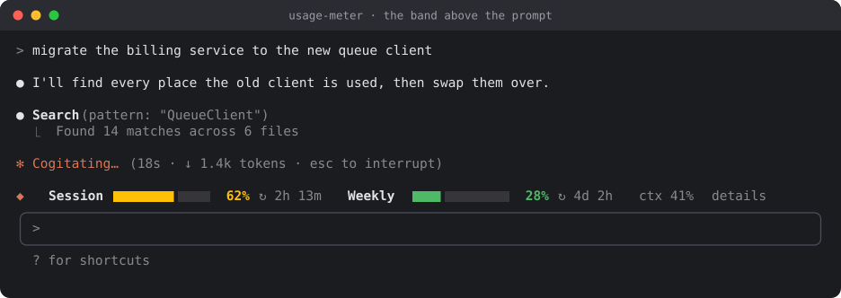
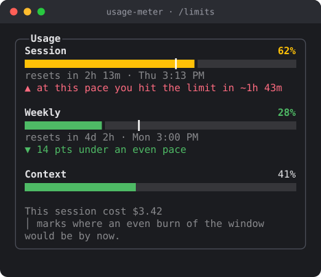

# claude-code-mods

Two small mods for the Claude Code terminal UI, and a workflow toolkit. Install any of them alone.

| Plugin | What it does |
| --- | --- |
| `usage-meter` | A row above the prompt with your session (5h) and weekly plan usage as bars, with the time until each resets. `/limits` opens a pane with pace, a hit-the-limit forecast, context and session cost. |
| `working-critter` | A tiny pixel crew trots at the top-right of the screen while Claude is working: the main critter leads, with one follower per running subagent, background shell and monitor. Terminal only. |
| `shipkit` | Your own `/<prefix>:*` workflow commands in any project (PRD → issue → PR / MR → checks → pre-merge review → ship, test playbooks, guided tours), forged from shared templates plus a profile scanned from the repo. `/shipkit:forge` installs or re-syncs them, committed or hidden from git; `/shipkit:harvest` brings improvements back. GitHub and GitLab. See [plugins/shipkit](plugins/shipkit/README.md). |

## usage-meter

`usage-meter` shows plan limits only on a Claude subscription, and only after the first reply. One quiet row sits above the prompt: a bar per limit (Session is the 5h window, Weekly the 7-day one), the percent used and the time until it resets. Bars are green while there is room, amber from 60% and red from 85%. On a narrow terminal the row stacks into lines.



`/limits` (or `details` on the row) opens a pane with more room. The white marker on each bar is where an even burn of the window would be by now, so you can see at a glance whether you are ahead or behind. Under it, a pace line: how many points ahead of or under an even pace you are, or, when the current rate would fill the window before it resets, when you would hit the limit. Context use and the session cost close the pane.



## working-critter

`working-critter` pins to the top-right in fullscreen mode (`"tui": "fullscreen"`). In the inline layout it stands on the working label's row instead. Its crew:

- **Main critter**: runs, dashes, hops, looks around, waves and turns back to check on its crew, picked at random. Thought dots while Claude thinks, sparks while a tool runs.
- **Subagents**: a smaller critter each, in its own color. It walks, hops, cheers or carries a box, and taps its foot while it waits.
- **Background shells**: a little terminal on legs typing output. When the command ends it flashes green or red, then goes up in a puff.
- **Monitors**: an eye-bot that scans side to side. Its antenna flashes and it hops when the monitor reports an event.

Newcomers drop in from above. Between turns, while background work is still running, the crew moves to a band above the prompt and the main critter sleeps beside it.

While Claude works, left to right: a monitor, a background shell, two subagents and the main critter. Here the monitor reports an event, the shell finishes (green flash, then a puff) and a new one drops in.



Between turns the crew waits in the band above the prompt, with the main critter dozing, peeking and stretching.



The images are SVG renders drawn from the plugins' own bar and sprite code, not terminal captures; the critter ones are animated.

## Install

At the prompt of a terminal session:

```
/plugin install usage-meter --marketplace sensus261/claude-code-mods
/plugin install working-critter --marketplace sensus261/claude-code-mods
/plugin install shipkit --marketplace sensus261/claude-code-mods
```

From a shell:

```
claude plugin install usage-meter --marketplace sensus261/claude-code-mods
claude plugin install working-critter --marketplace sensus261/claude-code-mods
claude plugin install shipkit --marketplace sensus261/claude-code-mods
```

The first time, answer `y` to "Add marketplace?", then pick the user scope so the plugin loads in every session. Once installed it is active at once, with no restart.

In the desktop app, where `/plugin` does not run: click + next to the prompt box, then Plugins, Add marketplace with `sensus261/claude-code-mods`, then Add plugin.

## Update

```
claude plugin marketplace update claude-code-mods
```

## Layout

```
.claude-plugin/marketplace.json     lists the plugins
plugins/usage-meter/                hooks/register.tsx, types/ (state contract), tests
plugins/working-critter/            hooks/register.tsx, tests
plugins/shipkit/                    skills/ (forge, harvest), kit/ (renderer, templates, profile guide), tests
```

Each mod is a self-contained hooks module: `hooks/hooks.json` points at `hooks/register.tsx`. `shipkit` is
skills plus a dependency-free Node renderer: `node --test plugins/shipkit/kit/*.test.mjs`.

## Develop

Load a mod from its folder for one session:

```
claude --plugin-dir plugins/usage-meter
```

Saving a file reloads it. Check and test it:

```
claude plugin validate plugins/usage-meter
claude plugin test plugins/usage-meter
```

## Tuning

`working-critter`: if the critter sits a row too low, lower `ROWS_BELOW_SPINNER` in `plugins/working-critter/hooks/register.tsx`. If it loses its top half off the screen, raise it.
